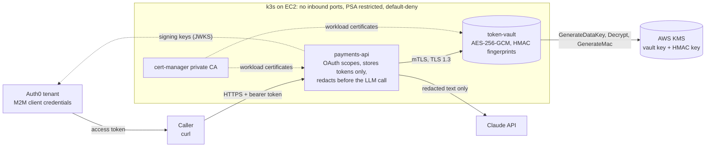
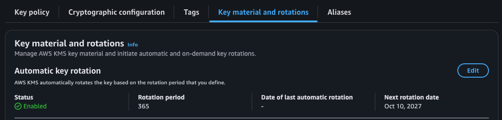

# Protected Payments API with an LLM Gateway

A payments-style API that never stores a card number. A token vault swaps each card for a random token and keeps
the card encrypted with AWS KMS envelope encryption. The two services trust each other through mTLS from a private
CA, callers authenticate with OAuth client-credentials tokens from Auth0, and a support-summary endpoint redacts
card and personal data before anything is sent to the Claude API. Controls are mapped to PCI DSS v4.0.1
Requirements 3 and 4.

Built and tested in October 2026 as a personal lab on a single k3s node in a dedicated AWS account.

> **Test data only.** The vault refuses every card number except published test numbers such as
> 4111 1111 1111 1111, and a pre-commit hook blocks any other card-shaped number from being committed.

## Architecture



Card numbers stop at the vault. Everything downstream of it sees a token, the last four digits, or a placeholder.

## What each control does

| Layer | Control | Where |
| --- | --- | --- |
| Data at rest | Tokenization; envelope encryption (one KMS data key per card, AES-256-GCM); keyed HMAC-SHA256 for duplicate detection | `services/token-vault/app/crypto.py` |
| Key management | Least-privilege key policies, separation of duties (the admin role can't decrypt), source-IP condition, automatic rotation | `infra/terraform/kms.tf` |
| Service to service | mTLS (TLS 1.3) through a cert-manager private CA; the vault authorizes callers by certificate URI SAN | `services/token-vault/app/serve.py`, `k8s/platform/pki.yaml` |
| API access | OAuth 2.0 client credentials (Auth0); signature, issuer, audience, expiry, and per-endpoint scope checks | `services/payments-api/app/auth.py` |
| LLM gateway | Card numbers tokenized, PII redacted, fail-closed check, metadata-only audit log, API key mounted from a Secret | `services/payments-api/app/redact.py`, `main.py` |
| Platform | Pod Security "restricted", default-deny NetworkPolicies, Kyverno signed-image and registry policies, Secrets encrypted at rest | `k8s/` |
| Supply chain | Gitleaks, Semgrep, Checkov, Trivy, Syft SBOM, keyless cosign signing, SHA-pinned actions | `.github/workflows/build.yml` |

## Evidence

Everything under `docs/evidence/` is command output, passed through `scripts/sanitize.sh` and reviewed before
commit. Text output was preferred over screenshots because it can be searched and diffed.



| Phase | What it shows | Evidence |
| --- | --- | --- |
| 0 | Hooks block a non-test card number; k3s Secrets encryption on; pods can't reach IMDS; no inbound rules; Pod Security and Kyverno each reject a pod | `phase0-*` files |
| 1 | Tokenization and duplicate detection; no card number in either database or the logs; the admin role can't use the key; a stolen key fails off the node; decrypt still works after an on-demand rotation | `phase1-*` files, screenshot above |
| 2 | First authenticated call over HTTPS, with the vault logging the caller's certificate identity | [phase2-first-call.json](docs/evidence/phase2-first-call.json) |
| 2 | Ten failure cases: no token, expired token, wrong audience, missing scope, no client certificate, rogue-CA certificate, wrong identity, blocked detokenize, NetworkPolicy block | [phase2-failure-tests.txt](docs/evidence/phase2-failure-tests.txt) |
| 3 | Notes with a card number, CVV, expiry, phone, and email leave the gateway fully redacted; the audit log holds only the redacted prompt | [phase3-audit-log.json](docs/evidence/phase3-audit-log.json), [phase3-log-check.txt](docs/evidence/phase3-log-check.txt) |
| 3 | Notes are redacted before storage; a caller without `support:summarize` gets 403 | [phase3-notes-and-scope.txt](docs/evidence/phase3-notes-and-scope.txt) |
| 3 | Summary and prompt-injection requests (see known gaps) | [phase3-summary.json](docs/evidence/phase3-summary.json), [phase3-injection.json](docs/evidence/phase3-injection.json) |

## Known gaps in this run

- **The Claude call itself failed authentication.** The cluster's API-key Secret didn't hold a working key, so
  each summary request returned `502 LLM provider error`, and the audit log recorded `"outcome": "error"`,
  `"error_type": "AuthenticationError"`. Everything before the call was still verified live: the outbound
  prompt was fully redacted (`[CARD tok_...] [EXPIRY] [CVV]`, `[PHONE]`, `[EMAIL]`), no raw value appeared in
  the logs, and the failure was handled without leaking content. The model call path is covered by unit tests
  against a mocked Messages API. Rerunning Phase 3 with a funded key is the next step.
- **IAM Roles Anywhere was designed but not deployed.** The vault still uses the Phase 1 IAM user. The Terraform
  (`roles-anywhere.tf`, off by default) and the sidecar manifest (`k8s/stretch/`) are in the repo.
- **One screenshot.** The rest of the evidence is sanitized text output.

## Workload credentials

The cluster is k3s, not EKS, so there's no IRSA or Pod Identity. The vault gets KMS access from an IAM user's
access key, mounted from a Kubernetes Secret as a file. That's the weakest link in the lab on purpose, and it's
limited four ways: the key policies accept it only from the node's Elastic IP and only for records tagged
`app=token-vault`; an inline Deny on the user allows only `GenerateDataKey`, `Decrypt`, and `GenerateMac` on the
two lab keys; IMDSv2 with a hop limit of 1 keeps pods away from the node's role; and k3s encrypts Secrets at rest.
The replacement is IAM Roles Anywhere, which would exchange the vault's existing cert-manager certificate for
one-hour credentials. Details: [docs/credentials-design.md](docs/credentials-design.md).

## Shared responsibility when sending data to an LLM

Checked against each vendor's documentation on October 10, 2026. These terms change, so re-check before relying
on them.

| | Anthropic API | OpenAI API | Amazon Bedrock |
| --- | --- | --- | --- |
| Consumption model | Direct API; my code decides what's sent | Direct API | API inside my AWS account boundary |
| Default retention | Commercial inputs and outputs deleted within 30 days | Abuse-monitoring logs up to 30 days; Responses API keeps state 30 days unless `store=false` | Per-Region mode: `none`, `default`, or `aws_review` (up to 30 days, inside AWS) |
| Training use | Not used for training without express permission | Not used for training by default since March 1, 2023 | Model providers have no access to prompts, completions, or logs |
| Zero retention | ZDR by agreement; covers the Messages API and eligible features | ZDR or Modified Abuse Monitoring, with OpenAI's approval | `none` mode, for models that allow it |
| Exceptions | Flagged content kept up to 2 years, even under ZDR | Longer where the law requires it | Abuse detection under `default` mode |

With a direct API, the provider controls retention and I control everything before the request leaves, which is
why the gateway exists. A managed SaaS product such as ChatGPT Enterprise moves the entry point to users typing
into the app, so DLP and admin controls replace gateway code. Bedrock keeps traffic in the AWS account boundary
with IAM, CloudTrail, and PrivateLink, under AWS's terms.

My side of the line in this lab: decide what leaves (tokens and placeholders only, with a fail-closed check),
protect the key (a Secret mounted as a file, one key per workspace), keep my own record (metadata and the redacted
prompt, never raw input), and treat model output as untrusted (scanned for card-shaped numbers before return).

Sources: [Anthropic data retention](https://privacy.claude.com/en/articles/7996866-how-long-do-you-store-my-organization-s-data),
[Claude Platform API and data retention](https://platform.claude.com/docs/en/manage-claude/api-and-data-retention),
[OpenAI API: your data](https://developers.openai.com/api/docs/guides/your-data),
[Bedrock data retention](https://docs.aws.amazon.com/bedrock/latest/userguide/data-retention.html),
[Bedrock data protection](https://docs.aws.amazon.com/bedrock/latest/userguide/data-protection.html).

## PCI DSS mapping

Requirement 3 (stored account data) and Requirement 4 (data in transmission), each control mapped to evidence,
plus the production gaps: [docs/pci-dss-mapping.md](docs/pci-dss-mapping.md).

## Troubleshooting

Problems hit while building this, with the cause and the fix.

### `aws ssm send-command` fails with `NoRegion`

- **Symptom:** `An error occurred (NoRegion): You must specify a region.`
- **Cause:** the IAM Identity Center CLI profile had no default region. Terraform worked anyway because its AWS
  provider sets the region itself.
- **Fix:** `aws configure set region us-east-1 --profile payments-lab`, or `export AWS_REGION=us-east-1` in the
  shell.

### Okta's free plan couldn't issue client-credentials tokens for this setup

- **Cause:** the Okta Integrator Free org blocked the client-credentials flow this lab needs for machine-to-machine
  callers.
- **Fix:** switched the OAuth issuer to Auth0's free tier: an API with identifier `api://payments-lab` and the
  three permissions (`payments:write`, `payments:read`, `support:summarize`), plus two machine-to-machine
  applications, each authorized for only the permissions it needs. `auth.py` was adapted to Auth0: signing keys
  come from `https://<tenant>.auth0.com/.well-known/jwks.json` rather than Okta's `/v1/keys` path, and scopes
  arrive in the standard space-separated `scope` claim, which the validator already reads.

### Every token fails with `wrong issuer` after switching to Auth0

- **Cause:** Auth0's issuer is `https://<tenant>.auth0.com/`, with a trailing slash, and the `iss` claim must match
  it exactly. The original validator stripped trailing slashes, which suited Okta's issuer format, so every
  Auth0 token failed the issuer check.
- **Fix:** keep the issuer exactly as Auth0 publishes it (change in `services/payments-api/app/auth.py`), and make
  sure the ConfigMap value ends in a slash. `cat -e` shows the end of the line:

    ```bash
    kubectl -n payments get configmap payments-api-oauth -o jsonpath='{.data.OAUTH_ISSUER}' | cat -e; echo
    # should end in: auth0.com/$
    ```

  Because the fix is in the image, push, wait for a green build, and redeploy (`scripts/deploy.sh` deploys the
  image built from the current commit).

### Gitleaks fails in CI on vault tokens in the evidence files

- **Symptom:** the `secrets-scan` job fails with `generic-api-key` findings on `tok_...` values in
  `docs/evidence/phase2-first-call.json` and `phase2-failure-tests.txt`, while the local pre-commit hook passes.
- **Cause:** vault tokens are random, high-entropy strings, so they look like API keys, but they're identifiers
  for public test cards, not secrets. A first allowlist used the newer `[[allowlists]]` table with
  `condition = "AND"`, which needs gitleaks 8.25 or newer. `gitleaks-action` installs 8.24.3 in CI, which silently
  ignores that table; the local hook runs a newer version, which is why it passed there.
- **Fix:** write `.gitleaks.toml` in the older syntax, which both versions read:

    ```toml
    [extend]
    useDefault = true

    [allowlist]
    description = "Lab evidence: vault tokens and KMS key material IDs are identifiers, not secrets"
    regexTarget = "match"
    regexes = [
      '''tok_[A-Za-z0-9_-]{20,}''',
      '''[0-9a-f]{64}''',
    ]
    ```

  There's deliberately no `paths` entry. In this syntax, paths and regexes are ORed, so adding
  `docs/evidence/.*` would switch off scanning for the whole folder. With regexes only, a real secret in the
  evidence folder is still caught. The trade-off is that any `tok_...` string or 64-character hex string in the
  repo is ignored. Optionally, set `GITLEAKS_VERSION` on the gitleaks step in the workflow to match your local
  version and close the gap.
- **Note:** there's no need to rerun the earlier failed run. CI scans only the pushed commit, and the next green run
  on `main` supersedes it.

### The support summary returns `502 LLM provider error`

- **Symptom:** `{"detail": "LLM provider error"}`, and the audit log shows `"error_type": "AuthenticationError"`.
- **Cause:** the `anthropic-api-key` Secret didn't contain a working key. A claude.ai subscription doesn't cover
  API usage: the Claude Console bills API keys from prepaid credits, separately. Pressing Enter at the key prompt
  creates an empty Secret, which fails the same way.
- **Fix:** buy a small amount of prepaid credit in the Claude Console (auto-reload off, which also acts as a
  spending cap), create a key, recreate the Secret, and restart the pod:

    ```bash
    kubectl -n payments delete secret anthropic-api-key
    read -rs ANTHROPIC_KEY
    printf %s "$ANTHROPIC_KEY" | kubectl -n payments create secret generic anthropic-api-key --from-file=api-key=/dev/stdin
    unset ANTHROPIC_KEY
    kubectl -n payments rollout restart deploy/payments-api
    ```

## What I'd do differently in production

- Workload identity with no static keys, and KMS through a VPC endpoint instead of a public IP.
- The vault in its own account and network segment, with segmentation testing.
- Edge tokenization (hosted payment fields), so payments-api never receives a card number.
- A CA with revocation and an offline root, and short-lived, automatically reloaded certificates.
- Central logging with alerts on unusual `Decrypt` volume and any `PutKeyPolicy` call.
- NER-based PII detection in the gateway, since regex redaction misses names.

The full list, mapped to PCI DSS, is in [docs/pci-dss-mapping.md](docs/pci-dss-mapping.md).

## Run it yourself

1. `infra/terraform`: the k3s node, KMS keys, and the vault's IAM user (`terraform apply` with an Identity Center
   profile that has a default region set).
2. `scripts/fetch-kubeconfig.sh` and `scripts/tunnel.sh`: reach the API server through SSM; there are no inbound
   ports.
3. `k8s/platform`: Kyverno policies and the private CA (cert-manager and Kyverno are installed with Helm).
4. Push to `main` and let `.github/workflows/build.yml` test, scan, sign, and publish the images. Make the two
   GHCR packages public.
5. Create the `payments-api-oauth` ConfigMap from `k8s/config/payments-api-oauth.env.example`. For Auth0, set
   `OAUTH_ISSUER=https://<tenant>.auth0.com/` (with the trailing slash) and `OAUTH_AUDIENCE=api://payments-lab`.
6. `scripts/deploy.sh` deploys both services by digest.
